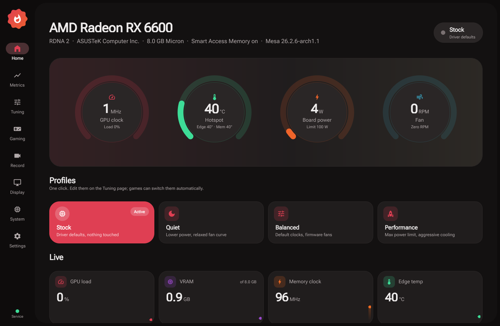
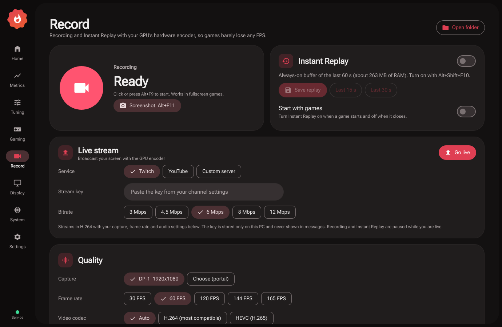
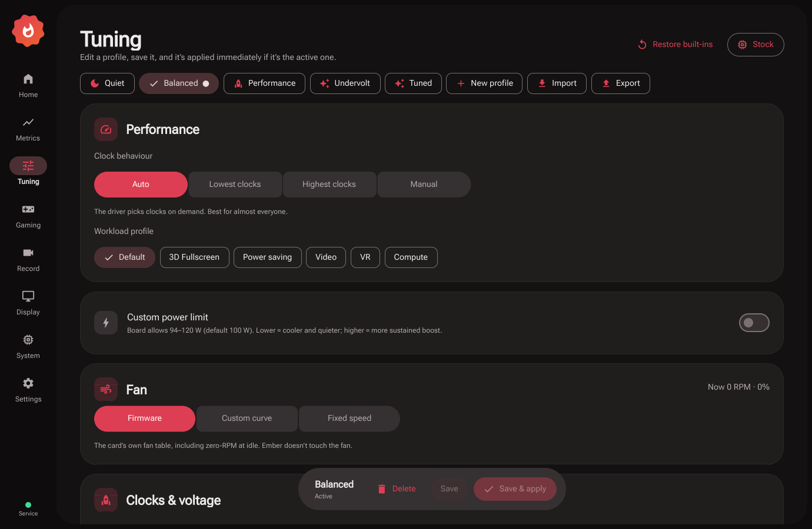
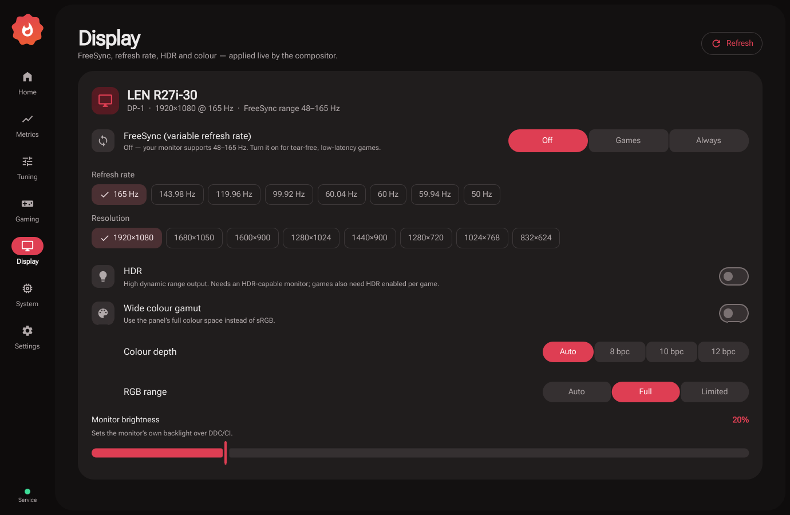

<div align="center">


# Ember: AMD Radeon control center for Linux

**The Adrenalin-style GPU app Linux never had.** Monitor, tune, overclock, undervolt, set fan curves, switch profiles per game, and turn on FSR 4, Anti-Lag, sharpening, Super Resolution and FreeSync, all from one open-source app. Built for Wayland.

[](https://github.com/noble6/ember-radeon/actions)



</div>

AMD publishes its Linux driver (amdgpu) and Mesa as open source, but the Adrenalin app is Windows-only. Linux users end up juggling LACT or CoreCtrl for clocks, MangoHud for overlays, vkBasalt for sharpening, gamescope for upscaling, environment variables for FSR 4 and Anti-Lag, and KDE settings for FreeSync. **Ember puts all of that in one app**, with a small, hardened root service doing the privileged work.

> Ember is a community project. It is not made, endorsed or supported by AMD.

## Features

| | |
|---|---|
| **Home** | Live gauges (clock, hotspot, power, fan), one-click profiles (Stock / Quiet / Balanced / Performance / your own), Smart Access Memory status, multi-GPU switcher |
| **Metrics** | 60 s charts for clocks, three temperatures, power vs. limit, activity, VRAM and fan; **per-app GPU and VRAM usage**; throttling reasons; DPM states; **record to CSV** |
| **Tuning** | Performance level, workload profile, power limit, **drag-and-drop fan curve** with hysteresis, **overclock and undervolt with the right controls for each GPU generation**, RDNA 3+ firmware fan options (zero RPM, target temperature, acoustic limits), apply at boot with a crash guard |
| **Gaming** | Steam library with artwork, **automatic game detection** ("Now playing" plus a notification) and an **in-game "Ember active" banner**. Per game: automatic tuning profile, **FSR 4 upgrade** (RX 6000 / 7000 / 9000), **FSR 3 and FSR 3 frame generation in any DLSS/XeSS game** (OptiScaler), **FSR Redstone frame generation**, **Anti-Lag**, **Super Resolution / Virtual Super Resolution / integer scaling**, sharpening (CAS), FXAA/SMAA, anisotropic override, Enhanced Sync, FPS target, HDR, performance overlay |
| **Record** | **Recording and Instant Replay** using the GPU's hardware encoder (H.264/HEVC/AV1), screenshots, desktop audio and microphone on separate tracks, **global hotkeys that work in fullscreen games** (Alt+F9 record, Alt+F10 save replay), replay starting with games automatically, clips filed per game, "REC" and "Replay saved" shown in game |
| **Display** | **FreeSync** (off / games / always) with the monitor's real FreeSync range, refresh rate, resolution, HDR, wide color gamut, color depth (bpc), RGB range, monitor brightness over DDC/CI |
| **System** | Full hardware and driver report, capability check, **shader cache reset** (Mesa and per-game), legacy `radeon` driver detection |
| **Tray** | Switch profiles from the system tray; the tooltip shows the live temperature and power |

> **FSR 4, FSR 3 (OptiScaler) and Redstone frame generation are experimental.** They depend on fast-moving community Proton builds and DLL swaps, and can crash, flicker or fail to launch in some games. Never use OptiScaler injection in online games with anti-cheat. Everything is per-game, so if a game misbehaves, turn the feature off for that game.

See [docs/FEATURES.md](docs/FEATURES.md) for the full **Adrenalin → Linux feature map**, including what isn't possible yet and why.

<p align="center">

</p>

<p align="center">


</p>

## Supported GPUs

Ember reads the amdgpu interfaces each card actually exposes and adapts, so it works across generations instead of supporting one family:

| Generation | Examples | Monitoring | Fan | Power limit | Overclock / undervolt |
|---|---|---|---|---|---|
| **RDNA 4** | RX 9070 XT, 9070, 9060 XT | Yes | firmware curve + zero RPM, target temp, acoustic limits | Yes | clock **offset**, memory clock, voltage offset |
| **RDNA 3 / 3.5** | RX 7900 XTX → 7600, 780M/890M APUs | Yes | firmware curve + zero RPM, target temp, acoustic limits | Yes | max/min clock, memory clock, voltage offset |
| **RDNA 2** | RX 6950 XT → 6400, Steam Deck, 680M | Yes | PWM curve (Ember service) | Yes | max/min clock, memory clock, voltage offset |
| **RDNA 1** | RX 5700 XT → 5500 | Yes | PWM curve | Yes | max/min clock, memory clock, **V/F curve** top point |
| **GCN 5 (Vega)** | Vega 56/64, Radeon VII, Vega APUs | Yes | PWM curve | Yes | top **power state** clock and voltage |
| **GCN 4 (Polaris)** | RX 580/570/480/470/560/550 | Yes | PWM curve | Yes | top power state clock and voltage |
| **GCN 1–3** | HD 7000, R9 200/300, Fury | Yes, on amdgpu | PWM curve | where exposed | top power state where exposed (Ember detects the old `radeon` driver and tells you how to switch) |
| **APUs** | Ryzen 2000 → AI 300 | Yes | - | where exposed | max GPU clock |

Several AMD GPUs at once (an iGPU plus a dGPU, or two cards) are supported: switch between them on the Home page. FSR 4 needs RDNA 2 or newer and is experimental on Linux. RX 6000 runs AMD's INT8 model, which is 10–20% slower than FSR 3 but sharper.

## Install

```sh
git clone https://github.com/noble6/ember-radeon && cd ember-radeon
./install.sh            # asks for your password once; installs to /usr/local + a systemd service
ember                   # or open "Ember" from your app menu
```

**Arch / CachyOS / Manjaro:** `packaging/aur/PKGBUILD`. **Requires:** Python 3.10+, PySide6 (Qt 6.5+), systemd. **Recommended for gaming features:** `mangohud vkbasalt gamescope gpu-screen-recorder` plus `proton-cachyos` or Proton-GE for FSR 4. The System page shows what's missing.

Uninstall with `./install.sh --uninstall`.

### Updates

Ember keeps itself up to date. Once a day a small system timer checks GitHub for a new release, downloads it, checks its Ed25519 signature against the release key built into Ember and installs it. The signing key is not stored on GitHub, so a release that was not signed by the maintainer is refused even if it appears on the releases page. The service restarts on its own, and the app restarts the next time it is sitting in the tray. You can turn this off, choose how often Ember checks (daily, weekly or monthly), check manually, or update right away from **Settings > Updates**.

Updates have a fail-safe. A release is test-loaded before it is installed, the version it replaces is kept, and if the service does not come back after the update, or the app cannot start, Ember goes back to the previous version on its own and does not try the broken release again. **Roll back** in Settings does the same by hand. Driver updates (Mesa, the kernel) never need an Ember update: Ember reads what your system provides each time it starts.

Installed from the AUR or another package? Then your package manager handles updates and the built-in updater stays out of the way.

### Unlocking overclocking

The kernel hides clock and voltage controls unless the overdrive bit is set in `amdgpu.ppfeaturemask`. **Tuning → Enable overdrive…** does it for you: it writes `/etc/modprobe.d/ember-overdrive.conf` and rebuilds your initramfs with mkinitcpio, dracut or update-initramfs. Then reboot. While overdrive is on, the kernel marks itself "tainted", which only matters if you file kernel bugs.

### Automatic undervolt

**Tuning > Find my undervolt** does the careful manual routine for you: it measures stock performance, lowers the voltage 25 mV at a time, loads the GPU after each step and stops at a crash, a GPU error in the kernel log or a drop in performance (a Radeon that is short on voltage often gets slower before it crashes). A step that only scores low is measured twice, so another program using the CPU does not end the search early. The search stops at -75 mV and the result, a third less than the deepest step that passed, is saved as a profile that is not activated until you choose it. It needs overdrive unlocked and the `vkmark` package, and works on RDNA 2 and newer. The test is short and light: it rules out settings that are clearly too low, it does not prove stability in every game. Treat the result as a starting point.

### Per-game graphics

Launch a Steam game with `ember-run %command%`; Ember can write that into the game's launch options for you. Automatic tuning-profile switching works with no launch options at all.

Games outside Steam (Flatpaks like Sober, Lutris, Heroic, Bottles, native games) are added from **Gaming > Add game**, which lists your installed apps with their icons and works out the process to watch for. **Create launcher** then adds a "Game (Ember)" entry to your app menu that starts the game with its Ember graphics settings. By hand, it is `ember-run --id exe:NAME -- command`. Graphics features inside a Flatpak need the Flatpak builds of MangoHud and vkBasalt.

## Safety

- **One privileged component.** `emberd` is the only thing that writes to sysfs. It runs under systemd sandboxing, with no network, a read-only system and only `/sys` writable. It clamps every value to the ranges the driver reports and **never raises voltage above stock**. Changes are accepted only from root, `wheel`, or the users listed in `/etc/ember/emberd.conf`.
- **Fans:** a safety floor sits on top of every fixed speed and curve. From 20 °C below any sensor's critical temperature the fan speeds up no matter what the profile says, reaching 100% at 5 °C below. If the temperature sensor stops answering, or the control loop fails, the fan goes back to the firmware. The same happens when the service stops for any reason, including a crash or a kill (`ExecStopPost`).
- **Service restarts:** an update or a crash restarts the service without dropping your active profile.
- **Local users:** anyone may read the state, only authorized users may change it. Requests are size-limited, idle connections time out, and connections are capped per user.
- **Laptops:** a discrete GPU that is powered down is left asleep; Ember does not poll it awake.
- **Boot guard:** if a boot with custom clocks doesn't survive 90 seconds, the next boot skips them.
- **Resume:** if the driver resets your settings after suspend, Ember re-applies them.
- **Steam config:** Ember edits only one value in `localconfig.vdf`, keeps the three newest backups, checks that nothing else in the parsed file changed, and refuses to write while Steam is running.

## How it compares

| | Ember | LACT | CoreCtrl | Adrenalin (Windows) |
|---|---|---|---|---|
| Clocks, power, fans, undervolt | Yes | | Yes | |
| Per-game automatic profiles | Yes | | Yes | |
| FSR 4 / Anti-Lag / sharpening / RSR per game | Yes | - |, | Yes |
| FreeSync, HDR, color depth controls | (KDE) | - |, | Yes |
| Per-app GPU usage, CSV logging | Yes | - |, | Yes |
| Shader cache reset | Yes | - |, | Yes |
| NVIDIA / Intel | - | Yes | - |, |

LACT and CoreCtrl are excellent, and Ember learned from both. Ember's focus is the complete, game-oriented Radeon experience.

## Development

```sh
python3 -m unittest discover tests   # fake sysfs trees for RDNA 1–4, Polaris and APUs; no root, no GPU needed
python3 main.py                      # run the app from the checkout
EMBER_SYSFS_ROOT=/tmp/fake EMBER_SOCKET=/tmp/e.sock python3 -m ember.daemon   # unprivileged service on a fake tree
```

| Path | What |
|---|---|
| `ember/core/` | stdlib-only: sysfs discovery and parsing, overdrive formats per generation, validation, games and launch options |
| `ember/daemon.py` | root service: JSON over a Unix socket, fan loop, game watcher, boot guard |
| `ember/app/` | Qt backend: telemetry, display (kscreen-doctor), caches, system report |
| `qml/` | Material 3 UI |
| `bin/ember-run` | per-game launcher wrapper |

Bug reports with the **System → Copy report** output are gold. Especially wanted: testers on RDNA 4, Vega, Polaris and APUs. See [CONTRIBUTING.md](CONTRIBUTING.md).

## License

GPL-3.0-or-later. Roboto Flex font under the SIL OFL.
